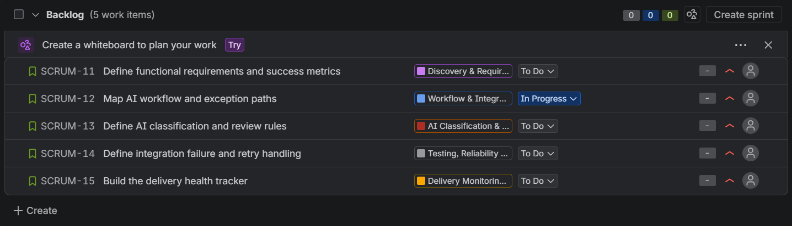

# Agile Delivery Health Tracker

### A Simulated Technical Program Management Project

A hands-on portfolio project demonstrating how a Technical Program Manager (TPM) can organise work, manage dependencies, monitor delivery risks, and communicate program health using Jira, Confluence, and Excel.

> **Disclaimer:** This is a simulated project created for learning and interview demonstration. It is not a production deployment. The workflow, owners, dates, blockers, confidence ratings, and outcomes are illustrative.

## Project Overview

### Objective
Build a lightweight delivery-monitoring system for a simulated AI support-triage program. The tracker brings together work-item status, dependencies, blockers, due dates, next actions, and milestone confidence.

### Problem Statement
Technical programs can lose delivery visibility when requirements, engineering tasks, dependencies, and risks are tracked across separate tools. A blocked upstream task can affect downstream work before the overall milestone is visibly delayed.

This project demonstrates a simple approach to improving visibility through structured Jira work items, documented workflows in Confluence, and formula-driven reporting in Excel.

### Key Capabilities
- **Work breakdown:** Organise the program into epics and stories with acceptance criteria.
- **Dependency tracking:** Identify upstream work that downstream tasks depend on.
- **Risk monitoring:** Record blockers, next actions, and milestone confidence.
- **Program health metrics:** Track total work items, overdue open items, and blocked open items.
- **Cross-tool traceability:** Connect Jira stories to Confluence documentation and display Jira issues in a Confluence table.

## Objective
Track work items, dependencies, blockers, due dates, milestone confidence, and program health for a simulated AI support-triage workflow.

## Tools & Architecture

### Tools Used

| Tool | Purpose |
|---|---|
| Jira | Organise epics and stories, define acceptance criteria, set priorities and statuses, and link dependencies. |
| Confluence | Document workflow stages, exception handling, delivery risks, and decisions. Display Jira issues in a live-linked table. |
| Microsoft Excel | Maintain the work-item tracker and calculate program-health metrics using formulas. |
| GitHub | Version and present the project documentation and tracker as a portfolio repository. |

### How the Tools Work Together

1. **Jira** is the source for work-item status, priorities, and dependencies.
2. **Confluence** documents the workflow and links back to the relevant Jira stories. Its Jira Issues table displays issue information from Jira and can be refreshed to reflect changes.
3. **Excel** provides a consolidated view of work items, owners, dates, blockers, next actions, and milestone confidence.
4. **GitHub** stores the project documentation and tracker for review.

## Simulated AI Support-Triage Workflow

### Objective
Design a proposed AI-assisted workflow that classifies incoming support requests, drafts responses using approved knowledge, and routes uncertain or sensitive cases to a human.

### End-to-End Workflow

1. **Receive Request:** Capture the incoming request and relevant ticket metadata.
2. **Validate Input:** Check required fields and flag malformed requests.
3. **Classify Intent:** Identify the request category and relevant priority.
4. **Retrieve Approved Knowledge:** Find relevant information from authorised support documentation.
5. **Draft Response:** Generate a response grounded in the retrieved information.
6. **Check Confidence and Risk:** Identify ambiguous, unsupported, sensitive, or low-confidence cases.
7. **Human Review:** Route cases requiring approval or specialist intervention.
8. **Update Ticket:** Record the approved response and ticket status.
9. **Log Outcome:** Record processing results, errors, and timestamps for monitoring.

### Exception Handling

| Scenario | Proposed Handling |
|---|---|
| Malformed input | Flag the request for correction. |
| Low-confidence classification | Route the request to human review. |
| Missing approved knowledge | Avoid unsupported claims and escalate. |
| Sensitive or unsupported request | Apply review and escalation rules. |
| Integration timeout or failure | Retry within defined limits, then alert the responsible owner. |
| Duplicate events | Use idempotency or duplicate checks to prevent repeated ticket updates. |

### Design Considerations
- Keep humans involved when confidence is low or the request is sensitive.
- Use approved knowledge to reduce unsupported responses.
- Define retry limits and escalation paths for integration failures.
- Log outcomes so failures and workflow performance can be analysed.

## Jira Work Breakdown & Dependencies

### Program Epics

The simulated program is organised into five epics:

| Epic Key | Epic Name | Purpose |
|---|---|---|
| SCRUM-5 | Discovery & Requirements | Define scope, functional requirements, and success metrics. |
| SCRUM-6 | Workflow & Integration Design | Map workflow stages, handoffs, and exception paths. |
| SCRUM-7 | AI Classification & Response Drafting | Define classification, knowledge retrieval, and human-review rules. |
| SCRUM-8 | Testing, Reliability & Readiness | Define integration failure handling, retries, and duplicate prevention. |
| SCRUM-9 | Delivery Monitoring & Handover | Track work items, blockers, dependencies, and program health. |

### Stories and Dependencies

| Story Key | Work Item | Parent Epic | Dependency |
|---|---|---|---|
| SCRUM-11 | Define functional requirements and success metrics | SCRUM-5 | None |
| SCRUM-12 | Map AI workflow and exception paths | SCRUM-6 | SCRUM-11 |
| SCRUM-13 | Define AI classification and review rules | SCRUM-7 | SCRUM-12 |
| SCRUM-14 | Define integration failure and retry handling | SCRUM-8 | SCRUM-12 |
| SCRUM-15 | Build the delivery health tracker | SCRUM-9 | None |

### Dependency Logic

The planned dependency sequence is:

- **SCRUM-11 → SCRUM-12:** Requirements definition precedes workflow design.
- **SCRUM-12 → SCRUM-13:** Workflow design informs AI classification and review rules.
- **SCRUM-12 → SCRUM-14:** Workflow design informs integration failure and retry handling.
- **SCRUM-15:** The delivery tracker can be developed in parallel with the workflow work.

### Acceptance Criteria

- **SCRUM-11:** Supported request types, expected outcomes, success metrics, and handling rules are documented.
- **SCRUM-12:** Workflow stages, inputs, outputs, handoffs, exception paths, duplicate handling, and escalation rules are documented.
- **SCRUM-13:** Supported intents, approved knowledge requirements, low-confidence handling, and sensitive-request test cases are defined.
- **SCRUM-14:** Failure scenarios, retry limits, escalation rules, duplicate prevention, and recovery tests are defined.
- **SCRUM-15:** Work-item status, target dates, blockers, dependencies, metric formulas, and weekly reporting requirements are tracked.

## Program health metrics
- **Total work items:** count of populated Jira issue keys.
- **Overdue open items:** items with a due date before today and status other than `Done`.
- **Blocked open items:** open items with a blocker recorded.

The included workbook uses formulas. The simulated scenario records one blocker on SCRUM-12. The overdue metric changes as due dates pass.

## Simulated delivery-risk scenario
SCRUM-12 is marked `In Progress` but blocked pending requirements review. SCRUM-13 and SCRUM-14 depend on SCRUM-12, so they may be impacted if the workflow-design dependency slips. This is a potential risk, not a confirmed delivery delay.

**Actions:** TPM follows up with the requirements owner; the Technical Owner assesses parallel work; the TPM updates milestone confidence and escalates if downstream milestones are threatened.

## Excel Delivery Health Tracker

The Excel workbook consolidates work-item details into a single view to help monitor delivery progress, dependencies, and risks.

**Workbook:** `Agile_Delivery_Health_Tracker.xlsx`

### Work Items Sheet

Each row represents a Jira story. The tracker records:

- Issue key, work-item title, and parent epic.
- Owner role, status, and priority.
- Start date and due date.
- Upstream dependency and current blocker.
- Next action and milestone confidence.

Owner names, dates, and confidence ratings are illustrative placeholders for this simulation.

### Program Health Metrics

The `Program Health` sheet calculates three metrics using Excel formulas:

| Metric | What It Measures | Why It Matters |
|---|---|---|
| Total Work Items | Number of work items with an issue key | Establishes the tracked delivery scope. |
| Overdue Open Items | Open items whose due dates are before the current date | Highlights work that may require follow-up or escalation. |
| Blocked Open Items | Open items with a recorded blocker | Surfaces impediments that may affect downstream work. |

### Simulated Metric Snapshot

At the time of the exercise, the tracker showed:

| Metric | Value |
|---|---:|
| Total Work Items | 5 |
| Overdue Open Items | 0 |
| Blocked Open Items | 1 |

These values represent the simulated scenario, not permanent results. The overdue count can change as dates pass or work-item statuses change.

### How the Metrics Support Decisions

- A rising overdue count can signal schedule risk and the need to review owners, dates, or dependencies.
- A blocked item prompts investigation into the cause, resolution owner, and next checkpoint.
- Dependency visibility helps the Technical Owner assess whether downstream work is at risk or can proceed in parallel.

The metrics are intended to support evidence-based discussion; they do not independently establish the cause or severity of a delivery delay.

## Delivery-Risk Simulation

> **Scenario:** Simulated for learning and interview demonstration; not a real production incident.

### Situation

SCRUM-12 — Map AI workflow and exception paths — is marked `In Progress` but is blocked pending requirements review.

SCRUM-13 (AI classification and review rules) and SCRUM-14 (integration failure and retry handling) both depend on SCRUM-12.

### Potential Impact

If the requirements review remains unresolved, workflow design may take longer than planned and could affect downstream sequencing or target dates. The downstream delay is a potential risk, not a confirmed outcome.

### TPM Response

1. **Clarify the blocker:** Contact the requirements owner to understand what remains outstanding and confirm a review date.
2. **Assess downstream impact:** Review the dependencies and ask the Technical Owner whether independent work can continue in parallel.
3. **Assign next actions:** Record the action owner, target date, and next checkpoint in the tracker.
4. **Update delivery confidence:** Reassess milestone confidence once the review date and scope are clearer.
5. **Escalate when necessary:** Raise the risk if downstream milestones are threatened or no clear resolution owner and date are established.

### Example Status Update

**Overall status: At risk**

SCRUM-12 is blocked pending requirements review. This may affect SCRUM-13 and SCRUM-14, which depend on the workflow design. The TPM will confirm the review date with the requirements owner, assess opportunities for parallel work with the Technical Owner, and update milestone confidence once the dependency is clarified.

### Decision Principle

Communicate the known blocker, distinguish potential impact from confirmed delay, assign concrete next actions, and establish a checkpoint for reassessment.

## Screenshots

### Jira Backlog
Shows the five stories, their parent epics, priorities, and current statuses.

### Confluence Live Jira Issues
Shows the workflow documentation and Jira Issues table linked to the five stories.

### Excel Program Health
Shows the delivery tracker and program-health metrics.

## Screenshots
("SCREENSHOTS.md")
